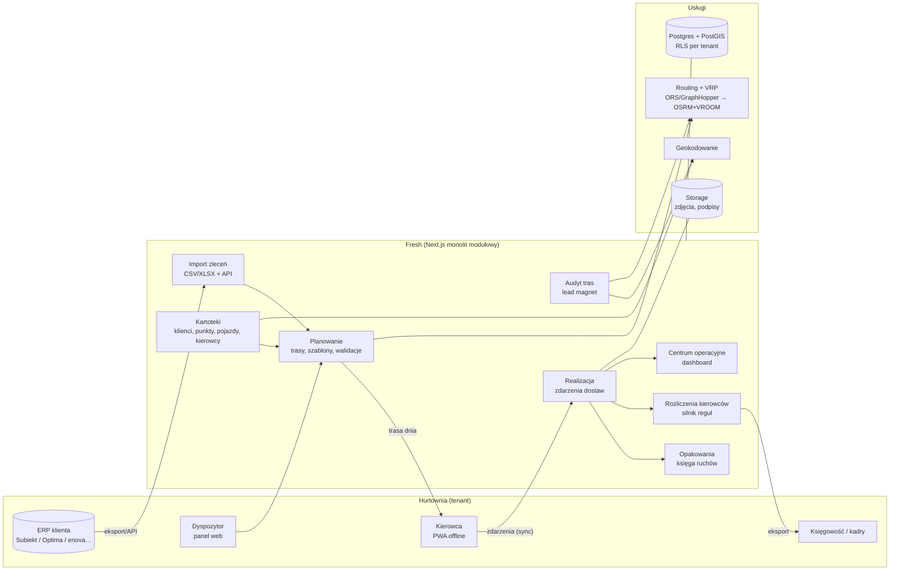

# Fresh — architektura MVP

Wersja: 0.1 (2026-10-25) · Właściciel: Arkadiusz Włoch

## 1. Kontekst i cel

Fresh to TMS dla hurtowni owoców i warzyw (oraz pokrewnych dystrybutorów świeżej żywności) obsługujących HoReCa własną flotą: **5–100 pojazdów**. Klient codziennie planuje dziesiątki–setki dostaw do restauracji z wąskimi oknami przyjęć, rozlicza opakowania zwrotne (skrzynki, palety) i wynagrodzenia kierowców — dziś głównie w Excelu, na telefonie i "w głowie dyspozytora".

Cel architektury MVP:
1. **Dowieźć pętlę dnia operacyjnego**: zamówienia → plan tras → realizacja w aplikacji kierowcy → potwierdzenie → saldo opakowań → rozliczenie kierowcy.
2. **Być od pierwszego dnia SaaS-em multi-tenant** (wielu klientów na jednej instancji), żeby każdy kolejny klient kosztował konfigurację, a nie wdrożenie.
3. **Mieć wbudowany silnik wzrostu**: "Audyt tras" — narzędzie, które z jednego pliku Excel prospekta liczy, ile kilometrów i godzin traci. To jest otwieracz sprzedaży i działa na tym samym silniku co produkt.
4. **Dać się budować jednej osobie z Claude Code** — mało ruchomych części, zarządzane usługi, jeden język (TypeScript).

## 2. Zasady architektoniczne

| Zasada | Co to znaczy w praktyce |
|---|---|
| Monolit modułowy | Jedna aplikacja, moduły z wyraźnymi granicami (`/modules/planning`, `/modules/packaging`…). Mikroserwisy dopiero, gdy coś realnie wymaga osobnej skali. |
| Multi-tenant od pierwszej migracji | Każda tabela biznesowa ma `tenant_id`. Izolacja przez Row Level Security w Postgresie, nie przez `WHERE` w kodzie. |
| Zdarzenia zamiast nadpisywania | Realizacja dostawy, ruchy opakowań, korekty to **zapisy append-only**. Salda i KPI liczymy z historii. To daje audyt, rozliczenia bez sporów i dane pod przyszłe AI. |
| Offline-first w aplikacji kierowcy | Kierowca w piwnicy restauracji nie ma zasięgu. Aplikacja zapisuje lokalnie i synchronizuje z kluczem idempotencji. |
| Logika biznesowa poza UI | Walidacje tras, kalkulator wynagrodzeń, salda opakowań = czyste funkcje w `/modules/*/domain`, pokryte testami. |
| Dostawcy zewnętrzni za adapterem | Geokodowanie, routing, optymalizacja, ERP — każdy za interfejsem. Zmiana dostawcy = nowy adapter, nie przepisywanie modułu. |
| Dane w UE | Hosting bazy w regionie UE (Frankfurt). RODO: dane osobowe kierowców i odbiorców. |

## 3. Stos technologiczny (decyzja)

| Warstwa | Wybór | Dlaczego |
|---|---|---|
| Panel dyspozytora | **Next.js 16 (App Router) + TypeScript + Tailwind + shadcn/ui** | Najlepiej "rozumiany" przez Claude Code, jeden język front+back, szybkie CRUD-y. |
| Aplikacja kierowcy | **PWA w tym samym repo** (`/driver`), IndexedDB (Dexie) jako kolejka offline | Brak sklepów z aplikacjami, jedna baza kodu, aktualizacja natychmiastowa. Natywna aplikacja dopiero w P2, jeśli PWA okaże się za słabe (np. tracking w tle). |
| Baza danych | **Supabase: Postgres + PostGIS** | Relacyjny model (to jest domena relacyjna), PostGIS do geografii, RLS do multi-tenant. |
| Auth | Supabase Auth (email + magic link; kierowca: login telefonem/PIN-em w P1) | Gotowe, zintegrowane z RLS. |
| Pliki | Supabase Storage (zdjęcia, podpisy, importy) | Te same uprawnienia co baza. |
| Realtime | Supabase Realtime | Dashboard dyspozytora widzi statusy punktów bez odświeżania. |
| Mapa | MapLibre GL + kafelki OSM (np. MapTiler) | Bez lock-inu Google Maps w UI. |
| Geokodowanie | Adapter; start: **Google Geocoding API** | Najlepsza jakość dla polskich adresów (ul. / os. / numery lokali). Wynik zapisujemy, płacimy raz za adres. |
| Macierz odległości + optymalizacja | Adapter; start: **hostowany OpenRouteService / GraphHopper (VRP)**, docelowo **własny OSRM + VROOM** na VPS z mapą Polski | Na start zero infrastruktury; przy kilku klientach własny serwer jest tańszy i bez limitów. |
| Zadania w tle | Supabase Edge Functions + `pg_cron` (lub Inngest, gdy zrobi się ciasno) | Importy, geokodowanie wsadowe, generowanie raportów. |
| PDF / raporty | Generowanie po stronie serwera (react-pdf) | Raport "Audytu tras", rozliczenie kierowcy. |
| Hosting | Vercel (aplikacja) + Supabase EU | Zero administracji serwerami w MVP. |
| Testy | Vitest (domena), Playwright (krytyczne ścieżki) | Rozliczenia i walidacje muszą być pewne. |
| Monitoring | Sentry + logi Vercel | Błędy aplikacji kierowcy zobaczysz zanim zadzwoni klient. |

## 4. Widok systemu

## 5. Moduły i granice

| Moduł | Odpowiada za | Właściciel danych | Udostępnia innym |
|---|---|---|---|
| `tenancy` | organizacje, użytkownicy, role (admin, dyspozytor, kierowca), ustawienia | `tenants`, `memberships` | kontekst tenanta w każdym żądaniu |
| `masterdata` | klienci, punkty dostaw, okna, wyjątki/święta, pojazdy, kierowcy, magazyny | kartoteki | odczyt kartotek, geokodowanie punktu |
| `orders` | import (CSV/XLSX z mapowaniem kolumn, API), ręczne zlecenia, podział/łączenie, anulowanie | `orders` | lista zleceń na dzień |
| `planning` | trasy dnia, kursy (1., 2. kurs kierowcy), szablony i kopiowanie, kolejność, walidacje (ładowność, okna), sugestia kolejności (VRP) | `routes`, `route_stops`, `route_templates` | trasa do realizacji |
| `execution` | API synchronizacji kierowcy, zdarzenia dostaw, wyjątki, załączniki | `delivery_events`, `attachments` | strumień zdarzeń |
| `packaging` | typy opakowań, księga ruchów, salda klient/kierowca, korekty | `packaging_movements` | salda |
| `payroll` | reguły wynagrodzeń (wersjonowane), naliczenie dzienne/miesięczne, eksport | `driver_pay_rules`, `driver_settlements` | eksport CSV/XLSX |
| `ops` | dashboard: mapa, statusy tras i punktów, opóźnienia, braki potwierdzeń | (tylko odczyt) | — |
| `growth` | Audyt tras: upload pliku prospekta → raport, przechwycenie leada | `route_audits` | — |

Zasada: moduł nie pisze do tabel innego modułu. Komunikacja przez funkcje serwisowe modułu (wywołania w procesie) lub przez zdarzenia z `delivery_events`.

## 6. Kluczowe przepływy

### 6.1 Dzień operacyjny
1. **Import zleceń** (wieczorem D-1 lub rano D): plik z ERP → mapowanie kolumn (zapamiętane per tenant) → dopasowanie do punktu dostawy po kodzie klienta / adresie → zlecenia `new`. Niedopasowane trafiają do kolejki "do wyjaśnienia".
2. **Planowanie**: dyspozytor startuje od **szablonów tras** (stałe trasy dzienne — tak pracuje 90% hurtowni), system wrzuca zlecenia na trasy po przypisaniu punktu do trasy. Resztę przeciąga ręcznie. Przycisk **"Ułóż kolejność"** wywołuje VRP dla jednej trasy (z oknami czasowymi). Walidacje działają na żywo: palety/masa/objętość vs pojazd, okna czasowe vs ETA, punkty zamknięte w dany dzień/święto.
3. **Wydanie trasy**: status `dispatched` → trasa pojawia się w PWA kierowcy (pobierana w całości do pamięci telefonu).
4. **Realizacja**: kierowca startuje trasę, na każdym punkcie: przyjazd → dostarczone / częściowo / odmowa / brak klienta, zdjęcie, podpis, opakowania wydane i odebrane, komentarz. Każda akcja = zdarzenie z `client_event_id` (UUID z telefonu) → sync, gdy jest zasięg. Duplikaty ignorowane.
5. **Monitoring**: dashboard pokazuje na żywo postęp tras, punkty spóźnione względem okna, brak potwierdzeń.
6. **Zamknięcie trasy**: dyspozytor zamyka trasę → naliczane są ruchy opakowań (księga) i pozycja rozliczeniowa kierowcy za dzień.

### 6.2 Offline i synchronizacja (aplikacja kierowcy)
- Trasa dnia + kartoteki punktów pobierane przy starcie (snapshot).
- Akcje zapisywane do kolejki w IndexedDB: `{client_event_id, type, stop_id, payload, occurred_at, gps}`.
- Synchronizacja: przy odzyskaniu sieci, w tle co 30 s, ręcznie przyciskiem. Endpoint `POST /api/driver/sync` przyjmuje paczkę zdarzeń, zapisuje idempotentnie (unikalny `client_event_id`), zwraca potwierdzenia.
- Zdjęcia i podpisy wysyłane osobno (upload do Storage), zdarzenie trzyma referencję.
- Czas zdarzenia = czas z telefonu (`occurred_at`) + czas serwera (`received_at`). KPI terminowości liczymy z `occurred_at`.

### 6.3 Audyt tras (silnik wzrostu)
1. Prospekt (lub handlowiec w jego imieniu) wgrywa Excel z jednym-trzema dniami dostaw: adres, godzina/okno, kierowca/trasa, opcjonalnie palety.
2. System geokoduje, odtwarza **obecne trasy** (kolejność z pliku), liczy km i czas.
3. Uruchamia VRP z tymi samymi pojazdami i oknami → **trasy zoptymalizowane**.
4. Raport PDF + strona web: km i godziny przed/po, koszt w zł/miesiąc (przyjęty koszt km i godziny kierowcy), mapa przed/po, punkty z konfliktem okien.
5. Lead zapisany (`route_audits`) z wynikiem → handlowiec ma konkretną liczbę na pierwsze spotkanie: "tracicie X km i Y godzin dziennie".

To ten sam kod (geokodowanie + routing + VRP), więc budowa audytu przyspiesza budowę planowania, a nie ją opóźnia.

## 7. Integracje

| Integracja | MVP | Później |
|---|---|---|
| ERP — zlecenia | **Import CSV/XLSX** z zapamiętanym mapowaniem + **REST API** `POST /api/v1/orders` (klucz API per tenant) | Natywny konektor dla ERP pierwszego płacącego klienta (Subiekt nexo / Comarch Optima / enova / WAPRO — decyzja po pilocie) |
| ERP — zwrotnie | Eksport CSV realizacji (WZ zrealizowane/częściowe) | Zapis statusów do ERP |
| Kadry / płace | Eksport XLSX rozliczeń kierowców | Formaty konkretnych systemów kadrowych |
| Geokodowanie | Google Geocoding (adapter) | Cache + ręczna korekta pinezki przez dyspozytora (już w MVP) |
| Routing / VRP | ORS lub GraphHopper hostowany (adapter) | Własny OSRM + VROOM |

Nie budujemy konektora ERP "na zapas" — każdy ERP to tygodnie pracy, a import pliku pokrywa pilot.

## 8. Bezpieczeństwo i multi-tenant
- `tenant_id` w każdej tabeli biznesowej, polityki RLS: użytkownik widzi tylko wiersze tenantów, w których ma członkostwo.
- Kierowca (rola `driver`) widzi tylko swoje trasy z bieżącego i poprzedniego dnia.
- Klucz `service_role` tylko po stronie serwera (importy, sync, zadania w tle) — nigdy w przeglądarce.
- Zdjęcia w prywatnym buckecie, dostęp przez podpisane URL-e.
- Log audytowy: kto zmienił trasę/rozliczenie/korektę opakowań (tabela `audit_log`).

## 9. Wydajność i skala (żeby wiedzieć, kiedy się martwić)
Największy docelowy klient: 100 pojazdów × 2 kursy × ~25 punktów ≈ **5 000 punktów dziennie**, kilkanaście zdarzeń na punkt ≈ 75 tys. zdarzeń dziennie. Dla Postgresa to mało. 20 takich klientów nadal mieści się w jednej instancji Supabase. Pierwszym wąskim gardłem będą limity hostowanego VRP — stąd adapter i plan przejścia na własny OSRM+VROOM.

## 10. Decyzje architektoniczne (ADR w skrócie)

| # | Decyzja | Alternatywy odrzucone | Powód |
|---|---|---|---|
| ADR-1 | Monolit modułowy Next.js + Supabase | mikroserwisy; osobny backend NestJS | jedna osoba + Claude Code; mniej infrastruktury |
| ADR-2 | Kierowca jako PWA offline-first | React Native / Flutter | szybkość dostarczenia, brak publikacji w sklepach; ryzyko: GPS w tle — w MVP GPS tylko przy potwierdzeniu |
| ADR-3 | Księgi zdarzeń (append-only) dla realizacji i opakowań | pola "saldo" aktualizowane w miejscu | audyt, korekty bez utraty historii, spory z klientami o skrzynki |
| ADR-4 | RLS jako mechanizm izolacji tenantów | osobna baza per klient | koszt i prostota; osobna baza możliwa później dla klienta enterprise |
| ADR-5 | Routing/VRP za adapterem, start hostowany | od razu własny OSRM | zero ops na start, migracja bez zmian w modułach |
| ADR-6 | Import plików zamiast konektorów ERP w MVP | konektor do jednego ERP od razu | nie znamy ERP pierwszego klienta; plik pokrywa 100% klientów od dnia 1 |
| ADR-7 | Optymalizacja kolejności jednej trasy w MVP (nie pełne auto-planowanie floty) | brak optymalizacji (wg P2) | VROOM daje to tanio, a to najmocniejszy moment demo i fundament Audytu tras; pełne auto-planowanie floty zostaje w P2 |
| ADR-8 | Next.js 16 z wyłączonymi Cache Components | Cache Components + Suspense wokół każdego odczytu sesji | cała aplikacja jest za logowaniem i per firma — statyczny „shell” daje niewiele, a komplikuje każdy ekran; wracamy do tematu przy stronach publicznych (Audyt tras) |
