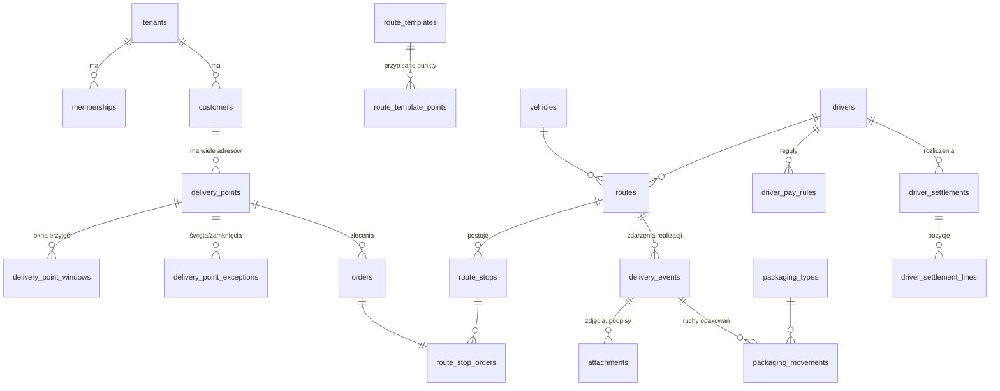

# Fresh — model danych (przegląd)

Pełna definicja: `supabase/migrations/0001_init.sql` (sprawdzona na Postgres 16 + PostGIS).

## Kluczowe decyzje modelu

| Obszar | Decyzja | Konsekwencja |
|---|---|---|
| Klient vs punkt dostawy | Klient (podmiot, NIP, kod ERP) ma wiele punktów dostaw; okna, dni dostaw, sezonowość i instrukcje są na **punkcie** | Sieć restauracji = jeden klient, wiele lokali z różnymi godzinami |
| Postój vs zlecenie | Postój = punkt na trasie; obsługuje 1..n zleceń | Dwie WZ do jednej restauracji to jeden przystanek, nie dwa |
| Szablony tras | `route_templates` + przypisanie punktów z kolejnością | "Przypisanie punktu do trasy" z kartoteki; codzienny plan powstaje z szablonów |
| Kursy | `routes.kind` + `course_no` | Drugi kurs, ekspres, awaryjny bez osobnych tabel; rozliczenie wie, co było kursem dodatkowym |
| Realizacja | `delivery_events` append-only, `client_event_id` unikalny | Offline bez duplikatów; pełna historia "kto, co, kiedy, gdzie" |
| Opakowania | Księga z podwójnym zapisem (`movement_group`), saldo = widok `packaging_balances` | Saldo klienta i kierowcy zawsze się bilansuje; korekty widoczne |
| Wynagrodzenia | Reguły jako JSON komponentów, wersjonowane `valid_from/valid_to`; pozycje rozliczenia z odwołaniem do reguły i trasy | Każda złotówka ma źródło; zmiana stawek nie psuje historii |
| Audyt tras | `route_audits` z `tenant_id` nullable | Prospekt bez konta; po podpisaniu umowy audyt podpinany pod tenanta |
| Izolacja | RLS: personel (admin/dyspozytor/viewer) widzi dane tenanta; kierowca tylko swoje trasy D-1..D+1; zapis kierowcy wyłącznie przez serwerowy endpoint sync | Bezpieczeństwo nie zależy od pamiętania o `WHERE tenant_id` |
